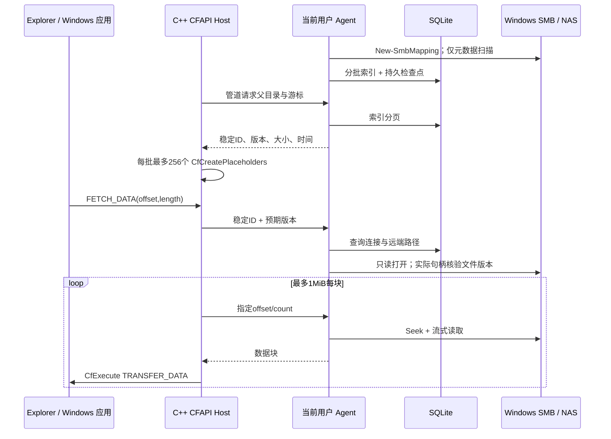

# 第二阶段：SMB、索引与 CFAPI

在原工程上新增 `CloudDrive.Storage` 与 `CloudDrive.Desktop`，保留第一阶段本地 `run --source`、注册、连接、身份校验和安全释放入口。当前为**远端只读数据源**，没有上传、双向同步或冲突解决能力。实际测试结论单独记录在 `PHASE2_VALIDATION.md`。

## 启动

```powershell
.\scripts\build.ps1 -Configuration Release
.\scripts\start-smb.ps1
```

在“SMB 连接管理”填写服务器、端口、共享、子目录、账号、密码、域/工作组、本地 NTFS 同步根。首次使用空同步根，父目录必须存在。依次保存、连接测试、扫描目录、启动 Agent。界面另有“存储状态”“任务日志”。密码编辑留空保留现有凭据；更换凭据前会停止此连接并仅断开已确认由本软件建立的映射。

“自动连接”在界面/`smb-auto` 启动时执行；“Windows 登录时启动 Agent”是独立的当前用户启动项开关。关闭界面会停止界面启动的 Agent。提权 Agent 是独立进程，使用停止按钮或 `smb-stop` 停止。自定义端口不会在登录时静默提升权限。

仅使用便携运行时时，可通过下面的入口执行 CLI，避免依赖系统安装位置：

```powershell
$dotnet = Join-Path $PWD '.tools\dotnet\dotnet.exe'
$agent = Join-Path $PWD 'artifacts\bin\CloudDrive.Agent.dll'
& $dotnet $agent smb-list
& $dotnet $agent smb-test '<连接GUID>'
& $dotnet $agent smb-scan '<连接GUID>'
& $dotnet $agent smb-run '<连接GUID>'
& $dotnet $agent smb-release '<连接GUID>' '目录\文件.bin'
& $dotnet $agent smb-stop '<连接GUID>'
```

新增也可使用 `smb-add --config <JSON文件>`，然后在交互控制台输入不回显的密码。JSON 字段为 `SmbConnection` 的构造参数，**不含密码**；`Id` 必须为新 GUID。编辑与删除可使用界面，删除配置保留同步根、本地数据和索引恢复证据，不会隐式注销非空根。

## SMB 与凭据边界

- `CredentialVault` 使用 Windows Credential Manager 泛型凭据，按连接 GUID 命名。SQLite 位于 `%LOCALAPPDATA%\CloudDriveLite\index.db`，仅保存配置和凭据引用，不存密码。
- `SmbMapper` 在当前进程内创建 PowerShell Runspace，通过 `AddCommand/AddParameter` 调用系统 `New-SmbMapping`，没有拼接脚本或密码命令行。
- 优先绑定 `PSCredential`；旧系统缺少 `Credential` 参数时，按系统 API 约束短暂转换为 `Password` 字符串。不得把此兼容边界描述为完全没有内存明文。参数集合和管线及时清理；异常记录只输出分类和状态码。
- 使用独立可用盘符作为内部读取路径，`Persistent=false`、`SaveCredentials=false`。最终呈现仍是本地 CFAPI 同步根。UNC 不含端口。
- 仅在映射创建成功后记录租约，绑定用户 SID、令牌 AuthenticationId、盘符、共享。删除前验证租约与实时映射一致，不枚举清除服务器会话或全局映射。成功建映射与写入租约之间若崩溃，宁可保留孤立映射，也不认领或删除无法证明归属的映射。
- Windows 同一服务器多账号限制仍存在，1219 被单独诊断；本软件不会断开其他程序连接，也不会通过别名绕过 Windows 凭据隔离。
- 自定义 TCP 端口检查 Windows Build 26100+ 与真实 `New-SmbMapping.TcpPort` 参数。仅该功能需要 UAC。界面以 `runas` 启动同一用户的专用 Agent；启动后核验 SID。映射、扫描、SMB 读取和 Host 均由该 Agent 管理，不假定普通令牌能看见提权映射。没有关闭签名、加密、NTLM 策略或证书校验。
- Runspace 遵循 PowerShell 的有效执行策略。不设置 Bypass、Unrestricted 或修改系统策略；系统若阻止加载 SmbShare CDXML 模块，显示 `SecurityPolicy`。这需要部署环境的受信任策略/签名流程解决。

## 诊断

`ConnectionTester` 顺序执行 DNS/IP、TCP、Windows SMB 映射/认证/共享、子目录与列表读取。`New-SmbMapping` 将协议协商、身份认证与共享树连接合并为一次系统操作，错误按原生状态分类，不伪造独立协议抓包结果。

区分 DNS、网络不可达、端口拒绝、超时、认证、1219、共享/子目录不存在、权限、自定义端口不支持、需要提权与策略阻止。CLI `smb-test <GUID> --write-probe` 可显式写入唯一命名的探测文件，使用 CreateNew 和 DeleteOnClose，只删除自己建立的文件；默认不探测写入。

## 索引、扫描与恢复

`RemoteScanner` 只枚举目录和打开文件元数据句柄，不读文件正文。每 256 项 SQLite 事务，目录队列和扫描代次持久化；扫描取消/异常保留旧索引。重启重读尚未完成的目录，复用已完成的目录检查点。索引读取采用父目录与路径游标分页。

稳定 ID 为连接 GUID 和大小写规范化相对路径的 SHA-256 前 128 位，不依赖数组或枚举顺序。另保存远端卷/文件 ID（优先 128 位 FileIdInfo，回退系统可用的文件索引）、大小、创建/修改时间。路径重命名产生新映射；跨重命名追踪留给下一阶段。非法 Windows 名称、重解析点会使扫描明确中断，避免越界与误标删除。无效零时间用其他有效时间或 Unix epoch 规范化。

仅完整扫描成功后将未见条目标为远端缺失，不删除本地占位或完整缓存。文件扫描不是 NAS 原子快照；并发远端编辑仍可能导致本次元数据视图不一致。打开水合文件时再次核验实际句柄的版本。若中断期间已排队的目录被删除，保留旧索引并将扫描标为 restart，下次从根重新遍历元数据；不能把该次访问失败当作目录所有文件已删除。

启动不清空索引，也不无条件全量重扫已有完整索引。自动恢复使用退避（最长 60 秒）与网络地址变化唤醒；Windows 唤醒后定时恢复继续运行。失效映射只对已确认的本连接租约重建。账号修改走停止、断开自己的映射、更新凭据流程。Native Host 监视 Agent 进程寿命，Agent 异常退出后断开 CFAPI，防止遗留 Host 长期占据根。

## 数据流与 CFAPI



管道协议 magic `CDL2`，当前用户专用随机命名管道，Native 核验管道服务端 PID。协议不发送密码或远端 UNC。最多 4 个同时服务会话，每侧每请求最多 1 MiB 缓冲，30 秒 I/O deadline；Native 每 100ms 检查取消/停止。打开的源句柄只共享读，保持到请求结束，阻止正常 SMB 写/删并发修改。

`FETCH_DATA` 采用回调要求的 offset/length，起点向下 4KiB 对齐，终点向上对齐并限制到 EOF，尾块按 EOF 例外处理。使用 FULL 水合策略也不假定每次回调请求完整文件。错误/取消发送失败完成状态；没有失败后标记 InSync 的路径。进度写入 SQLite 日志，CFAPI 传输进度另外上报。管道“已服务范围”与 Host 的“CFAPI 范围完成”分别记录，均不伪装为远端上传成功。

占位创建先检查已有项，只接纳本根身份。普通文件、脏文件和旧版本保留并记录，绝不覆盖或静默更新旧水合内容。远端变化后新水合会因旧身份失败；本阶段不自动替换已有旧版本占位，需后续显式版本更新流程。

文件使用 READONLY 属性，运行中拒绝删除/重命名回调，产品无上传入口。这能阻止标准应用直接保存；本地所有者仍可自行改属性/权限，且停止 Agent 后通知回调不生效。此限制不构成抵抗本机所有者的安全边界，不支持安全双向编辑。NAS 若不提供稳定文件 ID，或绕过 SMB 共享锁后保持时间/大小不变，客户端不能仅凭元数据证明内容版本未变化；强一致的服务端版本令牌仍需后续补充。

释放仍走原有身份/干净/未固定/内容 SHA-256 校验和受保护句柄流程。SMB 校验用同一流式管道；源锁失效则拒绝释放。Explorer 自行释放默认拒绝，使用 `smb-release`。异步文件句柄使用独立 OVERLAPPED 完成事件，失败不删除远端。

## 自动化与实际 NAS 验收

```powershell
.\scripts\test-all.ps1
# 有实际 NAS 且已保存连接后：使用受控测试文件和已知内容哈希
.\scripts\test-smb-nas.ps1 -ConnectionId '<GUID>' -RelativeFile '中文\大文件.bin' -ExpectedSha256 '<64位SHA256>'
```

NAS 脚本不接收密码。自定义端口测试应在界面批准的同用户提权会话/已获授权的管理员测试终端运行，不会修改安全策略。

需要实际 NAS/Windows 会话人工验收：正确445、自定义端口、错误账号、错误共享、多个服务器、NAS断电/恢复/重启、改密码、休眠/唤醒、登录恢复、Explorer 双击/图标、真实 NAS 1GiB+内存曲线。`Phase2Tests` 的 1GiB+ 是生成数据经过真实管道的测试，不能替代 NAS/CFAPI 大文件验收。

`IndexedCfapiTests` 使用本地只读测试源替代 NAS，真实运行同一个索引/管道/CFAPI Host；不会将本地 fixture 结果标为真实 SMB 通过。失败保留独立测试根、数据库和日志，禁止对这些非空根直接注销。

## 第三阶段接口准备

`IRemoteSource` 隔离枚举与版本校验读取；`IRemoteWriter.UploadAsync(expectedVersion, content, token)` 仅定义未来条件上传边界，没有实现，也没有 UI 调用入口。稳定 ID、远端文件 ID、版本元数据、扫描代次与现有文件身份为变更队列/冲突比较提供基础。仍需实现可靠变更令牌、上传事务、冲突副本、重命名关联、断点上传和本地变更监控后，才能开放编辑。

剩余限制还包括 IPv6、Windows 不支持的文件名、重解析点、约 2000 UTF-16 字符的现有 CFAPI 身份路径上限、最多可用盘符数的并行映射上限，以及系统 SMB 同步元数据调用的取消可能要等待 Windows 网络超时。没有缓存自动清理、归档、自动更新或上传。
