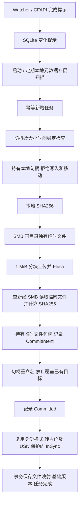

# 第三阶段首项：本地新增文件上传试验

日期：2026-11-20。当前只推进任务书规定的第一项：新增文件上传。**尚未通过真实 NAS 验收，第三阶段整体未完成，不支持安全双向编辑。** 没有继续开发修改上传、重命名、删除、远端变更或完整冲突处理。

## 最小改动与运行边界

继续使用现有当前用户 Agent、Windows 原生 SMB 映射、凭据管理器、SQLite 索引、命名管道与 C++ CFAPI Host。原有 FETCH_DATA、注册、身份格式和批量占位保持原实现。原生增加四种完成通知和有界提示队列；原有重命名、删除前置拒绝仍保留。没有在回调中进行 SMB、数据库或 stdout I/O。

新增上传默认关闭。只适用于测试专用连接中**不存在于既有索引（包括墓碑）中的普通本地文件**，远端父目录必须已存在。不会创建远端目录，不会替换已有远端文件。已有文件保持第二阶段只读属性；新增文件提交后也转为只读，直到修改上传单独验收后才应解除这条边界。手动移除只读属性后的修改不会回传，不可用于生产编辑。

同步中心提供连接范围的试验开关、上传并发（默认3）、防抖（默认2000ms）、任务阶段/重试/字节数/错误、暂停/恢复/取消待执行及打开本地位置。只有新增上传有执行器；其他任务枚举、冲突/删除表是后续预留结构，不代表相应功能已经完成。冲突任务当前只展示原因，不能自动解决或创建完整冲突副本。

## 数据流与恢复日志



`FileSystemWatcher` 事件是提示。Agent 使用容量4096的内存通道，持久化事件后统一补偿；溢出生成记录并触发扫描。没有提示时默认60秒做一次本地元数据补偿，配置存于 SyncSettings.ReconcileSeconds（5–3600）；这不是任务书后续要求的远端10分钟轮询。原生队列溢出也触发补偿。完整本地扫描结束才标记本次水位之前的提示已处理；扫描不读取所有文件内容。上传中的重复事件使用连接+文件路径稳定标识合并成同一任务。

任务阶段为 Queued → Staging → Copying → Uploaded → CommitIntent → Committed → Complete。唯一临时名与任务 GUID 关联，先写日志再创建。重试仅能截断已经记录同一远端 file ID 的自有临时文件。创建临时文件后、保存其 ID 前崩溃的极窄窗口会进入人工检查，不能安全证明归属时不截断、不删除。

提交采用 x64 FILE_RENAME_INFO 的 ReplaceIfExists=false，对持有的临时句柄执行同目录重命名。校验到提交期间拒绝其他写入/删除，避免回读后被替换；目标竞争出现同名文件则冲突。**实际 NAS 的句柄重命名、断电持久性及错误返回仍需实测。没有实现覆盖替换，也没有声称验证了 NAS 原子替换能力。**

恢复 Processing 为 Pending，保留阶段、SHA256、临时 ID、大小、mtime。若已记录 CommitIntent/Committed 且目标存在，必须核对暂存远端 ID、大小并重新读取哈希；同时重新核对本地 ID 与哈希。每次打开本地文件前仍检查大小与修改时间稳定，但不强求恢复时的 mtime 等于提交前日志：CFAPI 收尾可能已经按服务器时间精度对齐元数据。匹配才完成本地状态及数据库；不再次写入远端。内容变化、删除、同名竞争均保留双方并进入 Conflict。Completed 只在远端校验与本地 CFAPI 状态设置成功后写入。

失败指数退避2–300秒；不同文件默认并发3、上限8，同一文件仅一个 Processing。暂停停止认领，执行中的操作安全完成；取消仅允许尚未执行/失败/暂停的任务，CommitIntent/Committed 需要先核对，不允许丢弃。临时文件保留作恢复证据，没有自动清理。

## 数据库迁移与身份

`src/CloudDrive.Storage/Migrations/002_sync.sql` 是实际嵌入程序集执行的增量迁移，从 user_version 0/1 升至2，事务内创建 FileVersions、SyncTasks、FileChangeEvents、ConflictRecords、DeletedFileRecords、SyncSettings，保留原有表和数据。高于2的数据库拒绝打开，避免降级覆盖。FileVersions 当前行保存最后确认的本地/远端 SHA256、远端元数据与版本号，不再把普通扫描结果当作上传基础版本。

保持第二阶段路径散列 ID 和64字节原生身份头，未重写经过验证的水合身份。新文件也使用这一兼容格式。**该 ID 尚不支持重命名保持不变**：重命名阶段需要迁移为稳定实体 ID、增加旧身份别名和路径绑定，不能直接更改旧占位身份或使用扫描顺序。

已有文件索引或同步任务历史时，禁止更换连接来源/同步根、重用已删连接 GUID。保存任务不会把密码写入数据库；新代码仍通过已有 SmbMapper 建立连接，没有外部命令行密码或执行策略更改。

## 可复现入口

```powershell
.\scripts\build.ps1 -Configuration Release
.\scripts\test-phase3.ps1          # 23 项本地 fixture；显式替代 CFAPI finalizer，不是 NAS
.\scripts\test-phase3.ps1 -Cfapi   # 本地目录 + 真实 CFAPI；不是 NAS
.\scripts\test-all.ps1             # 保留失败，不把部分通过称为全部通过

# 先通过原有 SMB 页面/隐藏密码输入保存测试专用连接，再执行真实 NAS 验收：
.\scripts\test-new-upload-nas.ps1 -ConnectionId '<GUID>'

# 手工试验；默认关闭，必须使用测试专用共享及同步根：
.\.tools\dotnet\dotnet.exe .\artifacts\bin\CloudDrive.Agent.dll smb-sync-new '<GUID>' on
.\.tools\dotnet\dotnet.exe .\artifacts\bin\CloudDrive.Agent.dll smb-run '<GUID>'
.\.tools\dotnet\dotnet.exe .\artifacts\bin\CloudDrive.Agent.dll smb-sync-tasks '<GUID>'
```

NAS 脚本先检查连接诊断和可写权限，拒绝已有运行 Agent、未完成任务或未索引本地项目。临时启用新增上传，通过真实 Agent 自动发现唯一中文 TXT，校验最终 NAS 大小/回读 SHA256 及 native status 的 InSync。结束恢复原设置，保留本地/远端测试文件与日志。脚本不接收密码。首次 NAS 验收成功前不推进修改上传。

## 已知限制与后续关口

- 新增上传代码已编译，23 项本地 fixture 检查曾全部通过，包含真实调度器和本地文件 I/O，但以显式替代对象代替 CFAPI 收尾。最终全量回归及一次原入口复核时，测试程序集被应用控制阻止（0x800711C7）。实际 CFAPI 转占位、USN 保护与 InSync 收尾尚未运行通过；不能将本地 fixture 结果等同于端到端验收。
- 真实 NAS 配置/凭据缺失，内嵌 SmbShare 加载也受现有 PowerShell 策略阻断；需要在组织认可的受信任部署环境与可写测试 NAS 验收，程序不会更改策略。
- 第二阶段缓存释放仍会超时；既有本地文件保留。它是独立未通过项，本次没有重写或削弱其哈希与脏文件保护。
- SMB 数据 I/O 采用分块30秒取消窗口；部分同步 Windows 元数据、句柄重命名和 Flush(true) 仍受 Windows SMB 栈超时约束。
- 尚未验证真实 NAS 上传内存曲线、休眠/重启、凭据过期、共享权限变化、上传途中断电或 NAS file ID 稳定性。没有以本地磁盘或管道测试替代这些验收。
- 修改上传、目录创建/删除/移动、软回收站、远端轮询与缓存失效、双方修改冲突副本/解决界面均未实现。后续严格按用户顺序逐项开发及真实 NAS 测试。

后续已有任务/事件/版本/冲突/删除记录表、任务状态及接口边界可扩展；IRemoteWriter 的版本替换接口仍未接通，避免误认为已有安全覆盖能力。

实际执行结果、证据路径和未覆盖矩阵见 `PHASE3_VALIDATION.md`。
