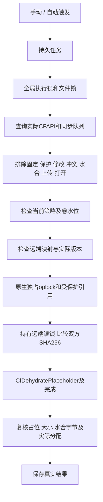

# 第四阶段：缓存管理

日期：2026-11-20。本阶段在既有工程内增加 Cache Manager，复用 SMB、SQLite 映射、Agent/Host 和受保护 CFAPI 释放路径。**真实 NAS 当前不可用，NAS 验收未执行；第三阶段完整双向同步也仍未完成。**

## 实现与代码入口

新增实际分配空间/水合字节统计、应用访问记录、三类独立清理策略、文件/目录固定与释放、持久任务及缓存页面。自动清理主开关及三个策略默认全部关闭。没有添加归档、远端删除/移动、修改上传或冲突解决，也没有用删除本地文件模拟释放。

| 文件 | 职责 |
|---|---|
| `src/CloudDrive.Storage/CacheModels.cs` | 状态、策略、快照、平台接口与安全筛选 |
| `src/CloudDrive.Storage/CacheStore.cs` | 分页快照、访问批写、保护规则、持久任务及结果 |
| `src/CloudDrive.Storage/CacheAccessTracker.cs` | 有界提示、访问分类、实际状态更新 |
| `src/CloudDrive.Storage/WindowsCachePlatform.cs` | CFAPI/实际分配/卷查询、原生操作及远端预检 |
| `src/CloudDrive.Storage/CacheManager.cs` | 校准、LRU/水位规划、复检、执行、恢复和调度 |
| `src/CloudDrive.Storage/Migrations/003_cache.sql` | v2→v3事务内增量迁移 |
| `src/CloudDrive.Desktop/MainForm.Cache.cs` | 缓存总览/文件、策略、历史及逐文件原因 |
| `src/CloudProviderHost/main.cpp` | 根策略更新、原生固定/水合/释放、进程提示 |
| `tests/CacheTests`、`tests/CacheNasTests` | 本地策略/真实CFAPI测试、NAS验收入口 |

`AgentRuntime` 在 Host READY 后启动访问记录和后台管理；原有 `smb-release` 接入同一安全检查。`NewFileUpload` 只增加共享文件操作锁，没有重写上传执行器。迁移保留原有文件、连接及同步任务；新增 CacheUsageStats、CachePolicies、CacheOperations、CacheExclusions 和 CacheRuns。已有缓存记录的连接也禁止直接改换来源/同步根。

## 注册策略与兼容更新

旧实现已采用 **Hydration FULL、Population ALWAYS_FULL**，但缺少 **AUTO_DEHYDRATION_ALLOWED**。新根补齐 modifier；已注册根仅在确认为本软件、精确根路径、相同来源身份后，通过 `CfRegisterSyncRoot(UPDATE)` 原地调整策略。

不注销、不删除或重建目录，不强制重新标记根 InSync；更新后重新比较根 file ID 与身份，原有文件身份格式不变。已有 ALWAYS_FULL 水合根也走该受控更新路径，更新失败则不继续连接。直接释放入口拒绝 ALWAYS_FULL 或缺失 modifier 的旧根，提示先启动 Agent 原地升级，不尝试不满足策略前提的直接释放。

补齐 modifier 后，旧版15秒释放超时在本地真实 CFAPI 回归中消失。旧根更新测试还验证根 ID、未同步内容及其原有占位/普通文件状态保留。更早报告保留历史失败，以[最新验证](PHASE4_VALIDATION.md)为准。

## 状态与统计

校准使用 `FILE_READ_ATTRIBUTES + OPEN_REPARSE_POINT`，查询 CFAPI 标准占位信息与 `FILE_STANDARD_INFO.AllocationSize`，验证根 ID、原身份 magic、连接/路径稳定 ID及路径。未知重解析点不递归。普通文件、身份异常和数据库映射缺失均保留内容。

区分逻辑长度、水合字节和实际分配字节；再结合 InSync、修改范围、固定、同步任务、未处理变化、冲突、活动水合和缓存任务，派生全部九种状态。按连接/同步根、目录、扩展名聚合，不把远端逻辑大小当作缓存占用。

物理统计为文件主数据流分配字节，不声称包含 NTFS MFT、SQLite、目录元数据或其他软件空间。CFAPI 直接水合到占位数据，没有本软件独立的下载临时文件；部分水合的占用计入对应文件。远端上传临时文件不计为本地缓存。

扫描实际本地命名空间，不依赖缓存行预先存在。每256条写入，数据库每512条键集分页；只有完整扫描成功才清除本次未见的快照，取消/失败不把未扫描项目记作释放。历史访问和任务保留。界面文件列表最多1000条，汇总覆盖全部已校准文件；目录/扩展名摘要最多80组。最近下载/释放是成功通知或状态跃迁的观测时间，未知时不编造。

## 访问时间

原生连接请求 CFAPI ProcessInfo，仅复制 PID、映像路径、文件路径和种类，不记录命令行。回调尝试写容量4096的内存队列，主循环转发至 Agent 容量8192队列，500ms批次持久化。

可识别的本软件检查不刷新用户 LRU；索引器、Defender、Explorer/dllhost 等归为后台或 Shell。未知打开保存实际时间，不赋予有效用户访问时间。仅进程信息存在、与当时前台 PID 匹配且不在后台分类中的打开，更新用户时间。时间字段单调更新，关闭提示减少打开计数。

无有效用户访问记录的文件始终排除自动清理。后台/未知打开不刷新 LRU，但有五分钟安全冷却；用户最近保护期同时约束容量/磁盘策略。提示计数仅是线索，最终由原生独占 oplock 验证文件占用。实际完整水合会校正丢失完成提示的下载计数；启动重置不可信活动计数，溢出触发校准。未配对关闭可能保守地延迟清理。

前台判断和进程分类属于启发式，无法准确识别全部缩略图、杀毒和主动使用场景；不确定时保留缓存。Explorer/Shell 本身的访问不算已确认用户访问。

## 策略、调度与恢复

默认7天保护、30天允许、90/180天优先；容量50/40 GiB高低水位；磁盘20/15/30 GiB预警/触发/目标；并发1–4。三类策略可独立启用。

每个 Agent 可启动后台组件，由当前用户全局调度文件锁选出一个调度者；也可独立运行 `smb-cache-watch`。后台先恢复 Processing 日志，每30分钟评估策略、每小时完整校准，策略变化或磁盘不足在10秒轮询内重评。低空间先校准，按卷 GUID统一预算，可用空间不按根重复相加，磁盘目标取同卷启用策略的最高值。

当前用户全局执行锁防止多个进程/根重复清理，上传与缓存共享文件锁。任务持久保存逐文件状态、前后分配、释放字节及错误。自动离线任务 WaitingRemote，重试原任务，避免重复入队。每批检查暂停/取消和最新水位；执行中的原生操作等待安全收尾，不强杀文件系统请求。重启总是重查实际状态，已释放文件不盲目重做。

候选按实际分配估算预算，执行前再核对水位；并发可能比目标多释放一个批次。无安全候选时不会强制释放。批次 Completed 可以包含安全 Skipped 项，详情展示原因，释放量按实际字节计算。

## 释放安全链



普通文件、缺失映射/墓碑、待执行/上传中/失败/暂停的同步任务、未处理修改、未解决冲突、NotInSync、修改数据、固定/保护、活动水合、打开提示及部分水合均禁止释放。部分水合暂时跳过，避免为哈希反而下载内容。

Native 再次验证身份、元数据、InSync、固定、独占访问和双方 SHA-256。远端读句柄限制写入/替换，保持至释放结束。不为释放调用 CfSetInSyncState。元数据/网络/回读失败保留缓存，不把不可访问误当作已安全保存。

释放完成后重新确认占位仍存在、逻辑大小保留、水合字节为零，才记录成功。原生调用失败也探测实际状态，不假设内容完全不变。没有离线强制释放入口。

## 固定、目录与保护

固定前持久保存保护意图，下载失败也不会进入清理。文件设置 PINNED 后执行实际水合并核对；目录设置自身状态并逐项处理已校准子项，不转换未知项目。目录规则保护未来子路径，显式取消子项固定可以覆盖父级固定意图，独立用户保护仍优先。

取消固定逐项调用 UNPINNED 并核对，整个范围成功后更新范围意图，不将取消固定直接记为释放。失败/暂停时保留未完成的保护，不声称整个目录已经完成。

## 复现

```powershell
.\scripts\build.ps1 -Configuration Release
.\scripts\test-cache.ps1            # 明确替代平台的策略/任务测试
.\scripts\test-cache.ps1 -Cfapi     # 增加实际Windows CFAPI，本地数据源
.\scripts\test-all.ps1              # 默认日志 artifacts/validation/phase4
.\scripts\start-smb.ps1

# NAS可用后，在专用测试连接中指定已存在的文件：
.\scripts\test-cache-nas.ps1 -ConnectionId '<GUID>' -RelativePath '缓存验收.bin'
```

NAS脚本不用命令行密码，不创建/删除远端文件；会水合、固定、取消固定、释放和重新水合指定文件，比较两端哈希。要求无运行 Agent、待同步/缓存任务或既有保护意图，测试期间关闭本连接自动策略，结束恢复设置。仅用于专用测试文件。

CLI：`smb-cache-refresh`、`smb-cache-status <GUID>`、`smb-cache-clean <GUID> [范围]`、`smb-cache-pin/unpin <GUID> <范围>`、`smb-cache-policy <GUID> [--config JSON]`、`smb-cache-runs`、`smb-cache-run <任务GUID> pause|resume|cancel`、`smb-cache-watch`。未指定范围的 clean 针对该连接全部符合安全检查的缓存。

## 限制与后续

- 真实NAS、实际断网、休眠/Windows重启、Office编辑、Explorer云朵图标及双击待验收。本地 CFAPI 证据不替代NAS。
- 第三阶段新增上传的实际转换仍失败：默认占位管理策略限制独立 Agent 在活动根下转换。缓存保留失败任务和内容，不放开占位管理权限；后续应让已连接 Host 受控执行转换并单独验收。
- 保留路径散列身份，重命名稳定实体ID及完整双向冲突处理仍待实现。缓存没有放宽这些边界。
- 同步 Windows/SMB 元数据、哈希或文件系统调用可能受 Windows 栈超时约束，取消不强杀执行中的原生操作。
- 全局锁覆盖当前用户及其提权令牌，不是跨所有用户的系统服务；百万文件规模及更多文件系统特性仍需性能验收。
- 未提供归档、离线强制丢弃或删除本地文件的清理模拟。

实际结果与未覆盖矩阵见 [PHASE4_VALIDATION.md](PHASE4_VALIDATION.md)。
