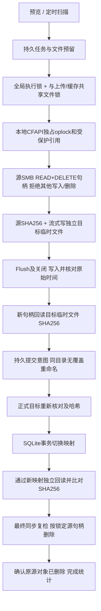

# 第五阶段：历史文件归档与存储映射

2026-11-20。基于现有 CFAPI、Windows SMB 客户端、SQLite、Agent 和缓存模块增加独立 Archive Manager。

**本轮完成归档迁移、映射读取、恢复、调度及界面；第五阶段完整验收尚未完成。** 当前没有真实双 NAS；第三阶段只有新增上传试验，已有文件修改回传未实现且其占位转换仍有历史失败。因此归档后继续采用现有只读保护，不能宣称归档文件已经支持安全双向编辑。

## 源码与数据库

| 入口 | 内容 |
|---|---|
| `src/CloudDrive.Storage/ArchiveModels.cs` | 配置、严格 AND 时间判断、状态、候选和映射模型 |
| `ArchiveStore.cs` | 持久任务、预留、日志、原子映射提交、统计和连接引用保护 |
| `ArchiveManager.cs` | 扫描、只预览、路径检查及逐文件原因 |
| `ArchiveExecution.cs` | 流式复制、回读校验、时间保留、映射切换、准确源对象删除及恢复 |
| `ArchiveLocalGuard.cs` | 实际 CFAPI 独占 oplock、受保护引用、锁定状态校验 |
| `ArchiveFile.cs` | 远端目录/文件元数据、目标容量、按句柄删除 |
| `ArchiveScheduler.cs` | 周/月计划、本地时区、执行窗口、补执行去重及启动恢复 |
| `Migrations/004_archive.sql` | v3→v4 增量迁移 |
| `src/CloudDrive.Desktop/MainForm.Archive.cs` | 配置、候选预览、执行中心和历史 |
| `src/CloudDrive.Agent/ArchiveCommands.cs` | CLI 管理与独立调度入口 |
| `tests/ArchiveTests` / `tests/ArchiveNasTests` | 本地故障及实际 CFAPI 测试 / 双连接 NAS 验收入口 |

迁移新增 ArchivePolicies、ArchiveRuns、ArchiveItems、ArchiveJournal、FileStorageMappings 和 ArchiveSettings；不重建原文件表、同步记录或缓存记录。原 `files` 保存逻辑身份和占位版本，新增表只保存物理存储路由，没有复制一套逻辑文件索引。未来版本数据库拒绝降级打开。

连接一旦被配置、映射或归档日志引用，不允许改换服务器/端口/共享/子路径/同步根，也不能直接删除连接与凭据入口；账号密码可继续通过现有安全配置更新。历史引用的清理/连接卸载流程尚未提供。

## 配置与预览

默认创建、修改时间均超过 180 天，使用 UTC 原始元数据，两项必须同时严格小于各自阈值。等于阈值、未知/不可靠时间均排除。Windows 元数据读取仍为既有水合保留回退值，但另外记录原时间可靠性和属性；归档不会把回退值当作可靠创建时间。

默认递归、保留相对目录；隐藏、系统、固定、使用中的文件排除。包含固定文件需要保存明确确认，不取消固定、不删除缓存；独立用户保护规则不能被包含固定选项覆盖。正在使用文件的迁移选项暂不支持，配置会明确拒绝。SHA-256 和时间保留不能禁用。

支持多个配置、周计划和每月 1–28 日计划、独立源/目标及共享子目录内相对路径、单次逻辑容量上限、并发 1–4、跳过/生成唯一冲突名/人工处理三类同名策略。默认跳过同名文件，提交时仍禁止覆盖；展平目录出现同名也会在提交处拒绝覆盖。

预览连接两端，仅枚举源元数据、查询目标同名情况及目标卷可用容量，不创建目录、不写临时文件、不水合本地文件、不删除源。返回所有候选/排除原因；界面最多展示 2,000 项，统计覆盖全部。扫描取消不会提交不完整候选；源列表与候选目前在内存保留，百万文件规模尚需性能验收。

源已有索引和有效同步占位是迁移前提。创建/修改条件、范围、属性、InSync、修改范围、未处理变化、同步队列、冲突、固定/保护及活动打开/水合均在预览及实际执行前检查。已归档文件不重复迁移，保留第一次来源和完整历史。此阶段没有迁回主 NAS 或二次归档功能。

## 安全迁移链



源和目标通过原 SMB Mapper 各自连接，使用已有 Credential Manager、凭据冲突诊断、自定义端口/UAC 限制。不拼接密码、不更改策略、不清理其他 SMB 映射。

源/目标先比较规范化范围，再比较现有目录与祖先的物理 ID，拒绝通过不同映射盘/别名将目录归档到自身子树。不同克隆卷若报告完全相同的卷/目录 ID，也会保守拒绝，需要调整范围或存储配置后验收。原生文件打开和无覆盖重命名增加长路径前缀支持，保留 Windows 组件名和 CFAPI 身份长度限制；本地超过 260 字符的迁移已有专项检查，真实 SMB 长路径仍待验收。

复制/哈希使用固定 1 MiB 池化缓冲，不把完整文件载入内存。流读写有每块 30 秒期限；取消、暂停、全局暂停和计划窗口在块边界/提交边界检查。Windows 同步元数据和网络栈调用仍可能受系统超时约束，不强杀文件系统操作。

目标临时名为同目录 `.clouddrive-archive-{ItemId}.tmp`。日志先保存实际临时文件 ID，再允许清空/续做该文件；无法证明归属的临时文件从不截断或删除。源变化时只删除能够按句柄验证归属且尚未提交的无效临时副本，源及已提交目标保留。

目标大小、完整 SHA-256、精确创建时间和修改时间必须一致，且正式目标再次验证。NAS 若不支持可靠时间保留，本次停在待恢复/冲突状态，保留源，不静默降低校验。服务器若不提供足够身份或共享锁能力，不应通过生产验收。

删除仅针对整个流程持有的源 READ+DELETE 句柄，通过 FileDispositionInfo；不按字符串盲删、不先删源、不碰本地占位，也不删除目标文件作为通用错误恢复。目标读锁一直保留到源删除确认。网络错误、父目录不可用和权限错误不作为“源已删除”；原源对象仍在则保持待恢复。源只读属性导致删除失败时保留映射及两端文件。

所有进程间锁限定当前用户环境。源服务器共享模式用于阻止其他 NAS 客户端写入，不能用本地锁替代；设备实际执行共享模式、元数据和句柄删除的行为仍须双 NAS 验收。

## 本地路径不变的实现

```text
原CFAPI占位：逻辑FileId / 本地相对路径 / 原占位版本（保持不变）
  -> FETCH_DATA -> SQLite逻辑文件
  -> ResolveStorage(FileId)
  -> FileStorageMappings：目标连接 / 目标RemoteEntry / SHA256
  -> 目标连接的Windows SMB客户端
  -> 版本检查 + 流式读取 -> 既有CfExecute分块传输
```

归档不重新注册根、不修改占位身份、不标记未同步内容为 InSync，也不水合/释放/取消固定本地内容。物理文件 ID 改变后，逻辑索引及原 wire 版本保持稳定；实际读取使用保存的目标物理版本进行校验。

`SmbBridge`、`WindowsCachePlatform` 通过同一映射解析访问目标；缺失目标连接或不一致映射时拒绝读取，不回退原 NAS。原主存储扫描不会覆盖归档逻辑条目，也不会把归档文件及其所需父目录标记消失。上传和归档临时路径从普通扫描中精确排除。

`ResolveStorage` 同时作为后续已有文件上传的目标接口。新增上传执行器遇到已归档 FileId 会拒绝写回原 NAS。**现有同步引擎仍未实现该接口之上的安全版本替换、连接中 Host 占位更新和冲突解决；当前不能编辑回传。** 不放宽只读属性来掩盖该前置缺口。

## 恢复与调度

单文件持久状态覆盖任务书的 Pending/Scanning/Eligible/Copying/Verifying/TargetCommitted/MappingUpdated/SourceDeleting/Completed/Failed/Conflict/Paused/RecoveryRequired，并增加安全取消/跳过状态。ArchiveJournal 保存每个持久边界的来源、目标、临时路径和错误；ArchiveItems 保存完整快照、两端哈希、物理 ID、进度和时间。映射提交及 MappingUpdated 日志在同一 SQLite 事务。

- 复制中断：原文件和已证明归属的临时文件保留；恢复重新核对源版本和哈希，可重启复制，不承诺断点续传。
- 重命名结果不明确：仅凭持久的临时 ID、提交意图、目标身份/元数据和完整回读核对接管，不盲目覆盖同名目标。
- 已提交目标但映射失败：两端保留，旧映射有效；恢复再次核对目标后提交。
- 映射完成但删源失败：保留新映射与目标，重试准确源对象的删除。
- 删除后但完成日志未写：已提交映射、目标校验及源实际缺失共同确认完成；不再迁移或删目标。
- 源已有新版本或目标身份异常：Conflict，默认不自动重试，需要处理实际副本。

全局执行锁与文件预留避免同文件被多个配置/进程同时迁移；每批最多 1–4 个不同文件并发。暂停/取消可以直接更新数据库，不被图形界面的长操作 gate 阻挡。取消仅取消未开始或没有已拥有临时/目标副本的项目；其余转为暂停以保留恢复责任。

默认周日 02:00，使用用户本地时区，每日允许窗口默认 120 分钟；周或月错过的周期合并为最近一期，持久唯一 DueKey 防止重复补执行。新配置不会补执行创建前的周期。跨午夜和夏令时按配置时区计算，缺失的夏令时时刻推到首个有效分钟。窗口外不开始新的自动提交；手动执行不受计划窗口限制。

Agent READY 后运行独立归档后台组件，也可以运行 `smb-archive-watch`。每 30 秒选取当前用户唯一调度者，恢复持久任务；未启用的自动配置不会新调度，手动授权的未完成任务可恢复。源/目标不可用时保留扫描计划和错误，按原任务重试，不制造一串新任务。进程未运行时不能执行；登录启动仍使用已有 Agent 设置。

## 界面与 CLI

新增第六页“归档管理”：配置列表、候选预览、执行与历史、哈希及逐文件错误。配置编辑器提供各时间、范围、计划、并发、容量、同名策略、重试及日志通知选项。统计把完成归档的逻辑字节与确认删源的逻辑字节分开；不能把它们等同于 NAS 实际物理腾出的容量（压缩/快照/去重可能影响实际磁盘空间）。

```powershell
.\scripts\build.ps1 -Configuration Release
.\scripts\test-archive.ps1          # 实际Windows文件IO + 明确替代的本地状态/保护
.\scripts\test-archive.ps1 -Cfapi   # 另加真实Windows CFAPI，两端仍是本地目录
.\scripts\test-all.ps1 -ValidationDirectory 'artifacts\validation\phase5'
```

```text
smb-archive-list
smb-archive-policy --config <JSON>
smb-archive-preview <配置GUID>
smb-archive-start <配置GUID>
smb-archive-history
smb-archive-run <执行GUID> pause|resume|retry|cancel
smb-archive-delete <配置GUID>
smb-archive-global pause|resume
smb-archive-watch
```

真实 NAS 入口必须使用两条专用测试连接和**创建/修改时间原本满足条件的可丢弃测试文件**，不修改业务文件时间。先启动源 Agent，并暂停新增上传、缓存自动清理及自动归档计划：

```powershell
.\scripts\test-archive-nas.ps1 -SourceConnectionId '<源GUID>' -TargetConnectionId '<目标GUID>' `
    -RelativePath '归档测试\专用旧文件.bin' -TargetDirectory '归档验收' -AllowSourceDelete
```

该入口会在完整校验及映射成功后删除指定源测试文件，再通过原本地占位路径读取并比对哈希。显式开关只用于防止误把业务文件当测试文件，不包含密码，不绕过任何系统权限。它不测试尚未实现的编辑回传。

## 验收边界与后续

完整性、恢复、实际 CFAPI 证据及未覆盖矩阵见 [PHASE5_VALIDATION.md](PHASE5_VALIDATION.md)。源/目标不同服务器、不同账号/端口、真实断网/会话过期、元数据不支持、NAS 磁盘耗尽、Office、多端修改、睡眠/Windows 重启、SMB 长路径及百万文件性能不能由本地替代平台证明。

后续先解决第三阶段的受控 Host 占位转换及已有文件版本替换，再接入映射感知写回并单独通过 NAS 冲突测试；随后完成真实双 NAS 迁移、故障和 Shell 双击验收。该前置工作完成前，保持只读归档来源，不将本阶段标为全部验收通过。
