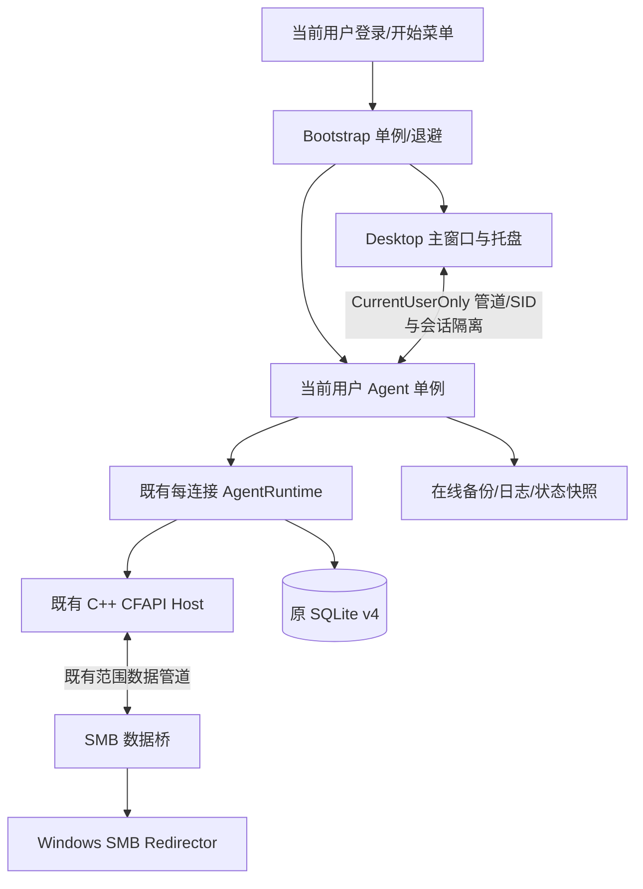

# 第六阶段：桌面运行与部署

2026-11-20。本阶段复用 Storage 内的 AgentRuntime、SMB Mapper、SQLite v4、缓存及归档引擎，保留 C++ CFAPI 的已验证数据路径。

## 修改前的进程关系

- Desktop 直接运行普通端口连接的 AgentRuntime，关闭窗口会取消连接和任务；CLI 的 smb-auto 是另一个长驻入口。
- 每个 AgentRuntime 持有连接锁、启动独立 CloudProviderHost，并运行恢复、上传试验、缓存和归档组件。
- Host 已监视 Agent 进程句柄，Agent 消失时退出并断开 CFAPI；同步根和占位保留。
- SQLite 使用 WAL 与 v2/v3/v4 增量迁移；Credential Manager 保存密码。数据已在当前用户 LocalAppData 中，不能升级时重建。
- 第一至第五阶段不等于完整产品验收：已有文件修改上传缺失，新增上传实际转换失败；真实 NAS 不可用。阶段六不能掩盖这些前置缺口。

## 目标进程关系

当前用户 Bootstrap → 唯一长驻 Agent → 每连接一个既有 Host。Desktop 负责窗口和托盘；关闭按钮隐藏窗口，明确退出通过当前用户管道协调后台安全停止。不使用 LocalSystem，不把普通445连接提升权限。自定义端口保留既有独立受控 UAC 流程。

逐步实施和验证：生命周期 → 启动与托盘 → 状态界面 → WiX安装 → 更新校验 → 在线备份恢复 → 脱敏诊断 → 卸载保护 → 回归与发布。正式证书、更新发布地址、真实 NAS 和干净 Windows VM 的缺失必须单列，不能由开发包构建代替。

## 交付状态

本阶段交付0.6.0未签名开发包，**不是完整产品验收**。用户确认暂无证书及HTTPS发布站点，先交付开发包。正式签名、真实安装生命周期、非空根卸载A/B、完整Fluent及长时间稳定性未完成。既有双向编辑也未完成，不能将任务书的前提视为事实。验证记录见[PHASE6_VALIDATION.md](PHASE6_VALIDATION.md)。

## 实际进程与数据路径

关闭窗口隐藏，不取消后台；明确退出先停止新任务并等待操作和根连接锁释放。不强杀文件操作、不注销根。Bootstrap以退出码和正常关闭标记区分崩溃，10分钟最多5次恢复，延迟2/4/8/16/32秒。Host重启由原AgentRuntime安全退出路径协调。登录启动只写当前用户Run项，默认关闭；普通445不提权，自定义端口沿用单独的同用户UAC入口。

## 源码位置

| 文件 | 作用 |
|---|---|
| `src/CloudDrive.Bootstrap/Program.cs` | 单例、采用已有Agent、退出监控、退避、更新安装入口 |
| `src/CloudDrive.Agent/ProductDaemon.cs` | 业务worker、管理请求、周期备份/更新、缓存状态、安全退出 |
| `src/CloudDrive.Agent/ProductCommands.cs` | 安装维护、卸载前检查、备份和诊断CLI |
| `src/CloudDrive.Storage/ProductEnvironment.cs` | 用户目录、版本、原子设置、进程启动、恢复预算 |
| `src/CloudDrive.Storage/ManagementProtocol.cs` | 当前用户/会话受限命名管道与固定请求模型 |
| `src/CloudDrive.Storage/ProductStore.cs` | SQLite汇总、未完成工作及孤立映射检查 |
| `src/CloudDrive.Storage/ProductBackup.cs` | SQLite在线快照、ZIP校验、离线保守恢复 |
| `src/CloudDrive.Storage/ProductMaintenance.cs` | 后台安全停止、多操作锁与维护标记 |
| `src/CloudDrive.Storage/ProductUpdate.cs` | 签名清单、HTTPS允许域名、断点下载、Authenticode、安装协调 |
| `src/CloudDrive.Storage/ProductLog.cs` | 有界异步JSONL、脱敏、按天/大小轮转及保留 |
| `src/CloudDrive.Storage/ProductDiagnostics.cs` | 脱敏预览导出与实际命名空间卸载检查 |
| `src/CloudDrive.Storage/LoginStartup.cs` | 当前用户登录入口 |
| `src/CloudDrive.Desktop/MainForm.Product.cs` | 首页、托盘、快照轮询、窗口重开、明确退出 |
| `src/CloudDrive.Desktop/MainForm.Operations.cs` | 更新、备份恢复、诊断和卸载检查页面 |
| `installer/Package.wxs` | 当前用户WiX MSI及安全维护动作 |
| `scripts/package.ps1` | 自包含发布、可选签名、MSI、源码包和校验文件 |
| `scripts/sign-artifacts.ps1` / `sign-update-manifest.ps1` | 使用Windows证书存储，不在命令行接收私钥密码 |
| `tests/ProductTests/Program.cs` | 产品化与可选空Agent生命周期测试 |

原生Host只加入10秒一次的CFAPI状态报告；水合、占位和释放逻辑未重写。IndexStore复用v4，旧数据库迁移前新增在线备份。SmbBridge统计活动读取；新增上传试验在认领时读取全局暂停设置。连接编辑/删除等待原连接锁，不丢弃已有受管根恢复入口。

## 更新、备份与诊断边界

信任配置不随开发包启用。正式配置需要固定RSA3072以上公钥、发布者证书DER的SHA-256、允许的HTTPS域名。清单验证原始payload签名、渠道、有效期、递增序号和版本，包验证长度/SHA-256/WinVerifyTrust/固定发布者。取消下载保留部分文件；安装前再次验证并持有包只读句柄，安全停止、备份、写维护标记后调用Windows Installer。失败保留备份和安装日志，不能盲目恢复旧任务数据库。

备份只含index.db/product.json/manifest.json，不导出凭据和文件正文。恢复只支持本产品v4 ZIP，检查路径、重复条目、限额、哈希与完整性，拒绝覆盖备份后改变的关键任务/文件/映射。需要离线操作锁，恢复前再备份；在暂存库暂停连接、上传与归档后提交。跨用户/设备需要重新核对路径和凭据。

诊断只导出环境与脱敏汇总，可先预览；不默认打包原始日志或数据库。原始JSONL可能保留相对文件名，不能宣称完全匿名。日志任务/文件关联字段允许空，尚未在全部既有业务点补齐。单文件有上限和日期保留，尚无整个日志目录总量上限。

## 部署及尚未完成项

MSI安装到当前用户LocalAppData/Programs/CloudDrive Lite，携带.NET10 win-x64运行时及桌面框架，Host使用静态C++运行库。因此不另交付下载运行时的Burn Bootstrapper。安装后的CloudDrive.Bootstrap.exe负责进程运行，不是安装引导器。版本统一0.6.0；MSI拒绝降级，重要数据不作为MSI删除项。

卸载目前仅实现安全检查与阻断：有连接/受管根/任务/孤立映射时拒绝移除。非空根方案A（全量下载后转普通文件）和B（核验后只清理本软件占位）**未实现**，用户应取消并保留程序和数据。不能用这一保护检查声称完整卸载向导已交付。

Desktop保留WinForms统一样式，八页与托盘可用；尚无完整WinUI3/Fluent、动态图标、所有首页业务指标。健康状态主要依赖最近报告，未独立检测心跳过期或卡住的Host；当前每3秒SQLite检查的开销需要下一阶段独立健康调度改进。24/72小时、10万文件、跨会话、睡眠唤醒、NAS恢复与实际部署均待测。

构建、复现、手册及完整测试结果见[验证报告](PHASE6_VALIDATION.md)、[安装使用](INSTALL_GUIDE.md)、[恢复指南](RECOVERY_GUIDE.md)、[兼容性](PHASE6_COMPATIBILITY.md)。
